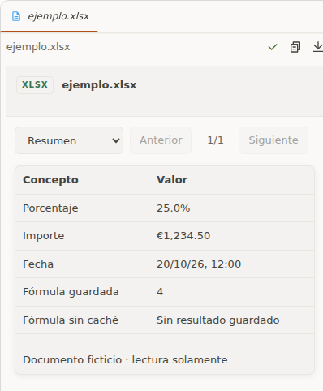
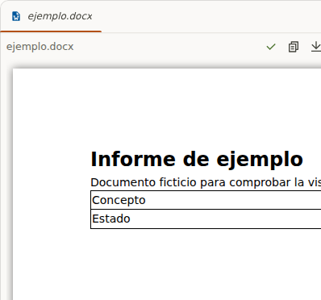
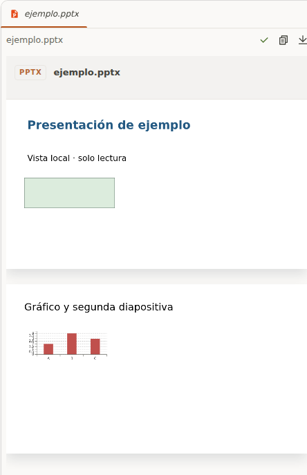

# Office Preview para OpenChamber

Visor local y de solo lectura de archivos **XLSX, DOCX y PPTX**, integrado en las pestañas de archivos de OpenChamber. Sin cuentas ni servicios de conversión externos.

## Instalación

Requiere **OpenChamber 2.5.0 o posterior**; la versión web 2.5.0 es la comprobada.

### Opción 1: URL Git

1. En **Settings → Extensions**, pega esta URL en el campo de instalación:
   ```text
   https://github.com/italovisconti/openchamber-office-preview.git
   ```
2. Selecciona la identidad Git si OpenChamber lo solicita y confirma la instalación.
3. Comprueba que **Office Preview** aparece habilitado y abre un documento desde el árbol de archivos.

El repositorio incluye el JavaScript compilado: no necesitas ejecutar un build. Para futuras versiones, utiliza las opciones de actualización de la extensión en OpenChamber.

**Alternativa SSH:** `git@github.com:italovisconti/openchamber-office-preview.git`. Requiere una identidad con acceso al repositorio. La identidad seleccionada pertenece a la instancia de OpenChamber y se reutiliza en las actualizaciones; **Global Identity** usa la configuración Git/SSH del servidor, no la de tu navegador.

### Opción 2: ZIP de la release

1. Descarga el **[ZIP precompilado v0.1.0](https://github.com/italovisconti/openchamber-office-preview/releases/download/v0.1.0/openchamber-office-preview-0.1.0.zip)** desde la [release de GitHub](https://github.com/italovisconti/openchamber-office-preview/releases/tag/v0.1.0). Usa ese archivo, no los archivos **Source code** del repositorio.
2. En OpenChamber, abre **Settings → Extensions** (Configuración → Extensiones).
3. Usa la opción de instalación desde ZIP, selecciona `openchamber-office-preview-0.1.0.zip` y confirma la instalación. **No lo descomprimas**.
4. Comprueba que **Office Preview** aparece instalado y habilitado en la lista de extensiones.
5. Abre tu proyecto y selecciona un `.xlsx`, `.docx` o `.pptx` en el árbol de archivos. La vista previa aparecerá dentro de su pestaña de archivo.

No hace falta compilar ni instalar dependencias para usarlo. El paquete pesa aproximadamente **1 MB**.

### Si no aparece la vista previa

- Confirma que la extensión está habilitada y vuelve a abrir la pestaña del documento. Si sigue sin aparecer, recarga OpenChamber.
- Comprueba que instalaste el ZIP precompilado, no **Code → Download ZIP** de GitHub.
- Prueba un documento sencillo de menos de 20 MB. Los archivos cifrados, con contenido activo o características no compatibles pueden ser rechazados.

Para quitarla, abre **Settings → Extensions** y desinstala **Office Preview**. Esto no elimina tus documentos.

## Qué ofrece

- **XLSX:** hojas visibles, valores y formato básico, navegación paginada y resultados de fórmulas guardados en el archivo.
- **DOCX:** texto, tablas e imágenes, con desplazamiento para páginas anchas.
- **PPTX:** diapositivas visibles, formas, imágenes y gráficos compatibles con el motor incluido.
- Recursos locales, temas claro/oscuro y sin botones de edición o guardado.

## Capturas

Vistas reales en OpenChamber con documentos ficticios de prueba. La representación es aproximada y puede diferir de Office.

**Hoja de cálculo (XLSX)**



**Documento (DOCX)**



**Presentación (PPTX)**



## Compatibilidad y límites

Probado en **OpenChamber web 2.5.0 con Chromium**. Desktop todavía no está probado. Máximo 20 MB por archivo, con límites adicionales de seguridad y tamaño de hojas. Se rechazan documentos con contenido activo, recursos externos y otras características no compatibles.

La representación es aproximada: no sustituye Microsoft Office, no recalcula fórmulas ni reproduce animaciones o vídeo. Las pruebas observaron los originales sin cambios; no constituyen una garantía universal sobre todas las versiones o rutas de guardado del host.

## Desarrollo

Consulta el **[README de la extensión](openchamber-office-preview/README.md)**, las **[pruebas y limitaciones verificadas](openchamber-office-preview/docs/verification.md)** y los **[avisos de terceros](openchamber-office-preview/THIRD_PARTY_NOTICES.md)**.

Código propio bajo licencia [MIT](openchamber-office-preview/LICENSE); los motores conservan sus respectivas licencias, incluidas en el ZIP.
